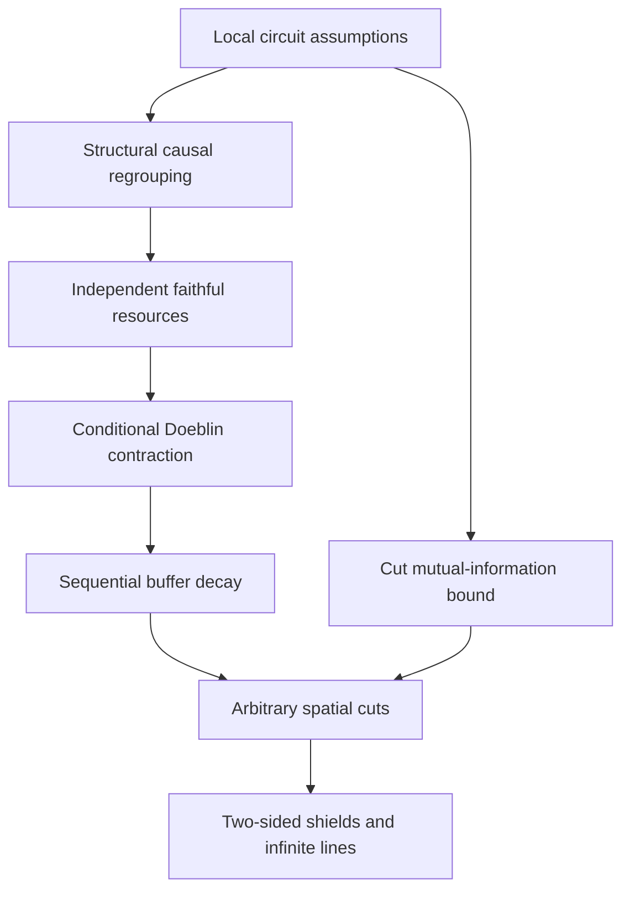

# Scientific account

The question is whether bounded-depth local quantum channels can create long-range conditional dependence from a full-rank product input. The result gives a uniform exponential bound for every faithful circuit in the stated one-dimensional model. It places the input and channel spectral assumptions directly in the preparation, so the conclusion does not depend on a guessed effective Hamiltonian or an assumed recovery circuit.

## Connected route

1. [Model and main result](model.md) fixes the tensor-product sites, gate supports, independence, uniform spectral floors and spatial geometries. It states the quantitative bounds and their finite-length consequence.
2. [Resource contraction](contraction.md) isolates the standard conditional-information mechanism. Its direct proof uses a mixture with identical emitted marginals; it does not assume generic convexity of CMI. The internal-channel formulation identifies the inherited Doeblin result.
3. [Causal regrouping](circuit-regrouping.md) works with the structural gate dependency graph. Ancestor-closed local subcircuits prepare independent block resources; all remaining operations occupy disjoint boundary strips. Uniform faithfulness gives their resource spectral floor.
4. [Spatial decay](spatial-decay.md) iterates the resource contraction, proves a cut area bound for small buffers, absorbs partial cells and derives the two-sided shielding inequality. It also explains finite boundaries and infinite lines.
5. [Examples and boundaries](examples-and-limits.md) derives usable faithfulness floors and interprets what uniform finite Markov length does and does not imply.

## Proof dependencies

The conditional contraction and sequential information-loss tools are established results. The circuit construction makes their assumptions available from the stated local preparation. The [related-work account](../references/comparison.md) explains this division and the closest theorem-level comparisons.

## Verification and interpretation

The [finite checks](../verification/README.md) address numerical entropy calculations, the structural grouping algorithm, nonunitary channel order and spatial chain-rule manipulations. Their negative controls distinguish the valid proof steps from two tempting invalid shortcuts. They do not establish the theorem for all dimensions or certify priority.

For the physical meaning, begin with the [examples](examples-and-limits.md), then return to the exact quantifiers in the [model](model.md). Uniform positive spectral floors are essential: a family of pointwise full-rank preparations need not have a common bound if those floors approach zero.
